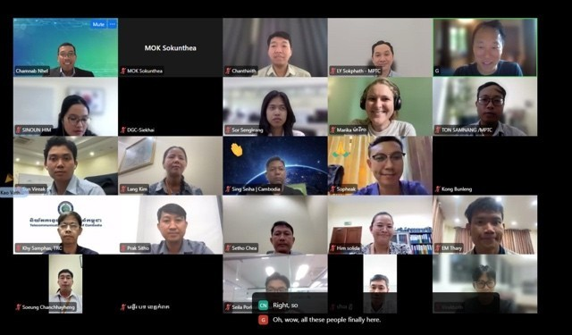
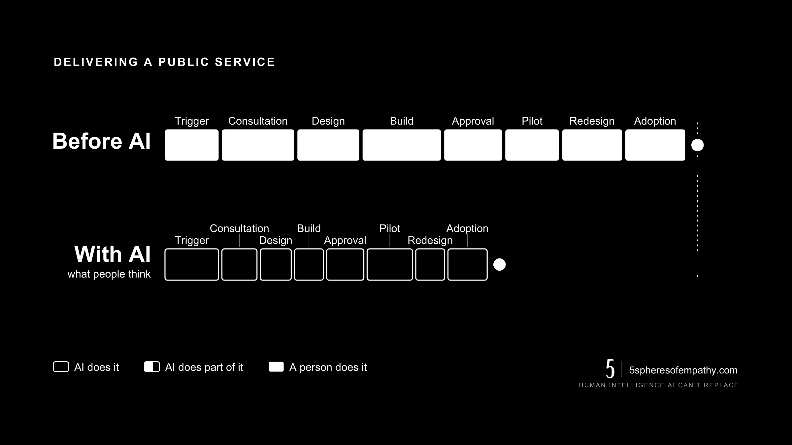
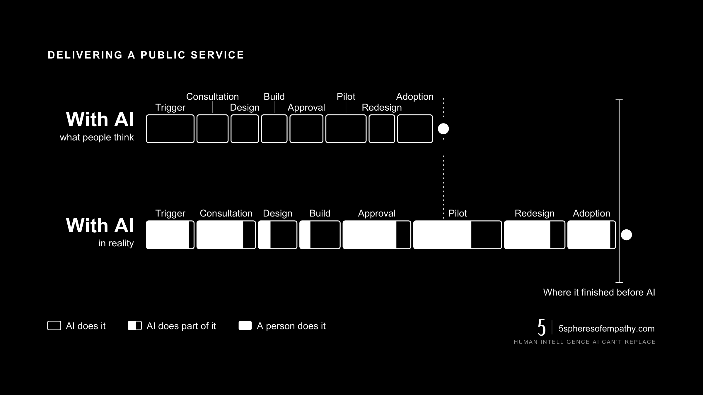
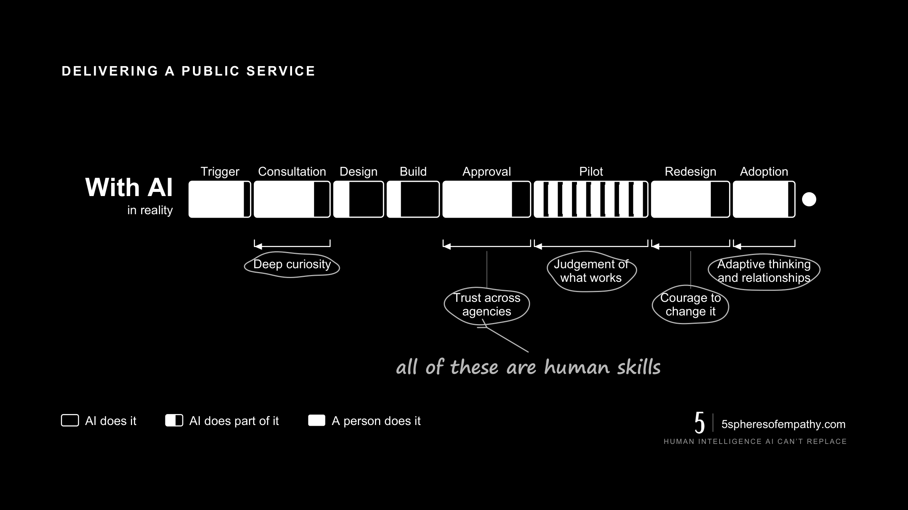

Unpopular opinion: a successful pilot is dangerous for a government programme.

“But G! It worked with 1,000 people!” you say.

That’s exactly why it’ll break with a million and more.

Last week I spoke to more than 150 civil servants at Cambodia’s Ministry of Posts
and Telecommunications about artificial and human intelligence in public service.

<figure>
  
  <figcaption>Ministry of Posts and Telecommunications, Cambodia. More than 150 in the room.</figcaption>
</figure>

## The journey of any programme

I showed them the journey of any programme: trigger, consultation, design, build,
approval, pilot, redesign, adoption.

Before AI, every stage was a white box of human work. The assumption now is that AI
turns them all black: unseen, automated, done.

<figure>
  
  <figcaption>White is human work. Black is the box you cannot see inside.</figcaption>
</figure>

But the reality is not quite as sexy.

AI really has made design and build quicker. But judging what’s actually right,
getting the project off the ground, and getting people to adopt it, takes as long as
ever. Sometimes longer.

<figure>
  
  <figcaption>Two stages went dark. The rest stayed yours, and the programme lands no sooner.</figcaption>
</figure>

<figure>
  
  <figcaption>The questions were the best part.</figcaption>
</figure>

When a well-designed strategy fails in implementation, is it leadership, culture, or resistance to change?

Chanthirith asked it during the questions.

The answer: strategy is just a theory. If execution is poor, you never find out
whether the strategy was good or bad.

Good execution starts with leadership and flows down into culture and teams. That’s
the part you can control.

Now whether citizens actually use and benefit from the programme, that shifts control
down to influence. So you need fallbacks, check every assumption, execute well and
pray.

## Why scale breaks things

The best explanation I’ve heard on why scale breaks things comes from Kazuo Inamori.
In *A Compass to Fulfillment* he describes how a company has to rethink its whole
system each time it grows by roughly a factor of three. Going from 9 staff to 27
changes HR, tax, sales, even the office.

Going from a 1,000-person pilot to a million citizens is far more than three times.

Of course it breaks.

McKinsey found that fewer than a third of companies ever scale their pilots
company-wide.

## What carries a programme through

What carries a programme through that jump is completely human: the ability to adapt,
curiosity, courage, patience, care.

<figure>
  
  <figcaption>Every stage that did not go dark is carried by one of these.</figcaption>
</figure>

And empathy, which isn’t a soft feeling. It’s human intelligence: understanding how
people physically feel, what they’re thinking, and how they’re emotionally
responding. That’s how you design for the resistance that will always come.

Lee Kuan Yew once said, “If good people don’t go into politics, bad people will.”

In the spirit of Wang Yangming, whose teachings shaped the samurai code, the highest
roles need people of the highest virtue, with the smartest executors working
alongside them. This way you can at least trust that your strategy was built on what
is right to do, not just the most popular or even the most efficient thing to do.

Trees for the forest, am I right?

---

My life mission is to bring more empathy and compassion into the world. And I see the
strengthening of institutional leadership and capability as one of the biggest
enablers of that outcome.
