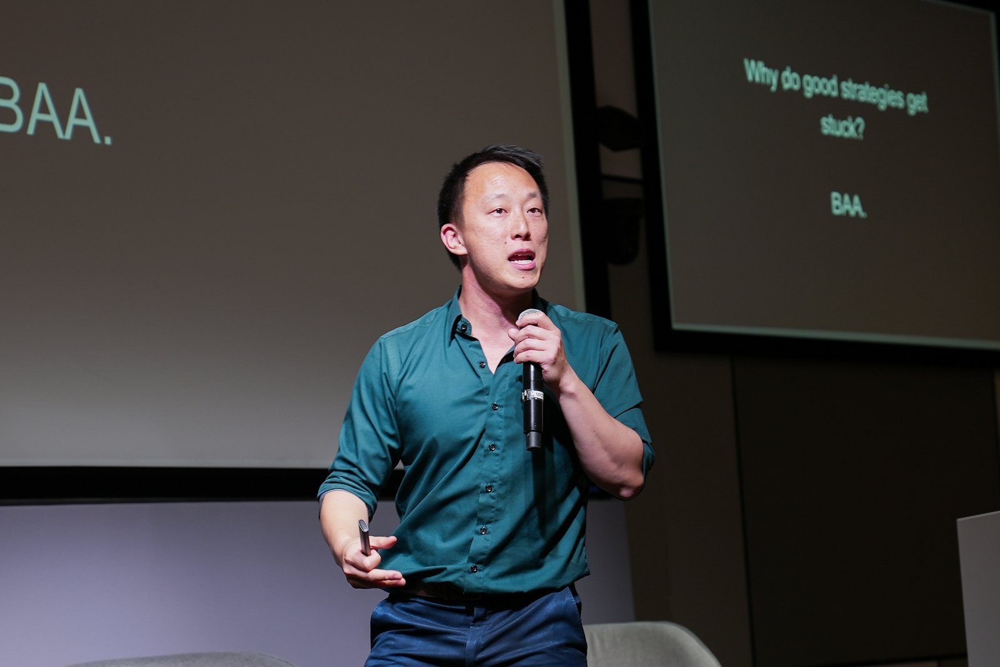
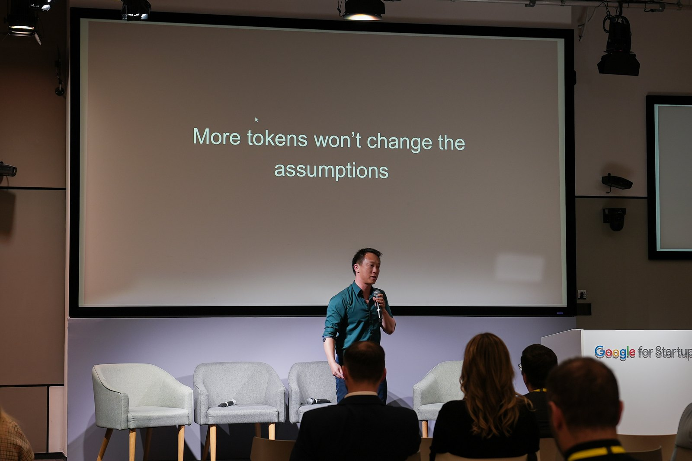
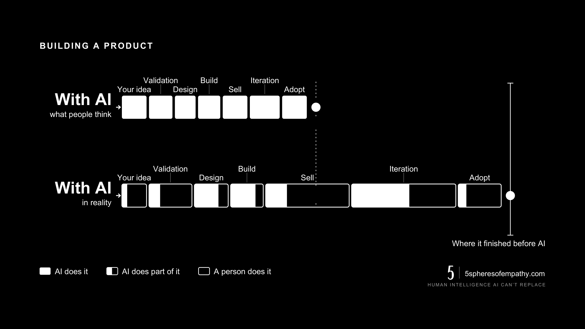
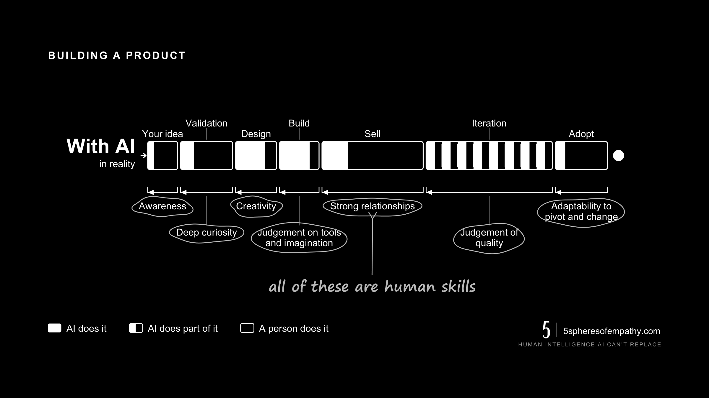
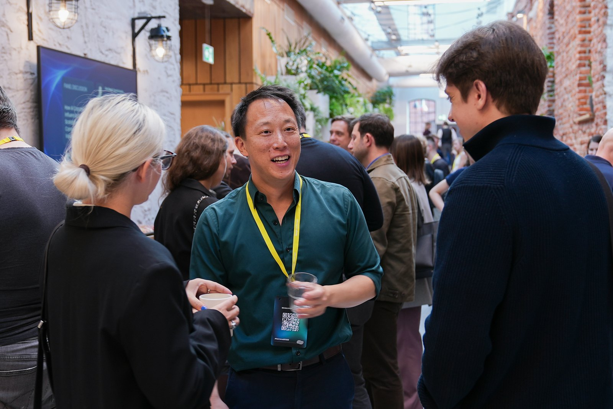

<figure>
  
  <figcaption>Google for Startups campus, Warsaw. Keynote on why good strategies get stuck: the human side of AI.</figcaption>
</figure>

Three years after ChatGPT 4, it is now clear that AI has done the complete opposite
of helping us skip the hard human parts of business.

And I flipping love it. We’re seeing the light now.

End of the tunnel nowhere in sight, but hear me out. 😅

AI has pumped out more competition for almost everyone in service.

- From up and down your supply chain,
- to ex-staff and colleagues,
- your neighbour, their aunty.

Everyone can build virtually anything now. Oh, and it’s buffed up your competition too.

But.

It hasn’t made building a business any faster. Because your business isn’t your product.

AI makes building better, only if there’s quality human judgement.

AI improves user experience, only if the team has deep curiosity and intuition for
the market.

AI closes deals faster, only if the sales team nurtures great relationships.

The list goes on and on, and it’s not limited to building a business. It’s virtually
every sector that’s now AI-powered, and even AI-native.

**AI multiplies the human judgement you already have. Or it exposes the lack of it.**

So the companies missing the human side, the design, the empathy, the care for the
person on the other end: they’re not hidden by AI. They’re now standing out more for
all the wrong reasons. More noise. More slop.

The ones winning are the most empathetic. The ones who still understand who they’re
building for.

## The sale isn’t the finish line

<figure>
  
  <figcaption>More tokens won’t change the assumptions.</figcaption>
</figure>

“Even after a product is sold, real adoption can sit as low as 15%.”

That’s what Yev Nesin, Global Growth Strategy &amp; Solutions Lead at Google Workspace,
said on his panel at the Google for Startups campus last week.

The sale isn’t even close to the finish line in growth. Getting humans to actually use
your product is, and it’s still painfully low.

I was there to keynote on why good strategies get stuck: the human side of AI, and
almost all the speakers and panelists were landing on the same place.

Mariusz Gąsiewski, CEE Mobile Gaming &amp; Apps Lead at Google, summarised it sharply.
What used to take months now takes days, but growth is harder than ever. And the new
moat is now ambition, appetite for risk, capital, and determination.

Notice what’s not on that list.

The tech.

Building is no longer the advantage now that everyone, their aunty and next door
neighbour can do it. What’s left is the human stuff, with empathy being the key skill
to growth.

## What that looks like on a timeline

Here is the same argument drawn as a timeline, with what everyone expects AI to have
done to building a product on the top row and what happens underneath it.

<figure>
  
  <figcaption>Design and build really do collapse, and the time comes back somewhere else: selling takes longer when the people you are competing against ship at the same speed, and iteration runs eight rounds where it used to run two. The row lands on the mark it landed on before.</figcaption>
</figure>

The time did not disappear. It moved into the parts a machine cannot do for you.

<figure>
  
  <figcaption>Every one of those is a human skill. AI did not remove them from the job. It made them the job.</figcaption>
</figure>

## Where this goes next

<figure>
  
  <figcaption>Between talks. The conversations after are usually the reason to go.</figcaption>
</figure>

This is the conversation I’m most looking forward to having at the ASEAN Startup
Connect in a couple of weeks.

In an AI-native world, the most human skills are the ones worth building.

This is what I’ve spent years mapping, and it’s the heart of the 5 Spheres of Empathy.
The tools are live and the book is on the way.

Grateful to Lviv IT Cluster and Irina Rudenko for having me, and for these shots. 🙏
